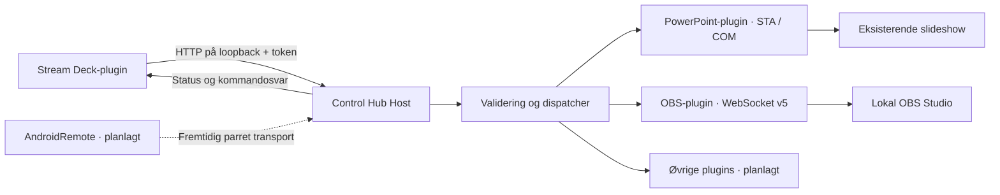

# Projektbeskrivelse: Control Hub

[English](project.en.md) · [Forside](../README.md)

## Formål og brugssituation

Control Hub skal samle styringen af præsentation, billedproduktion og udvalgte enheder i ét lokalt system. En operatør skal kunne fremføre slides og skifte OBS-scener fra samme Stream Deck uden at flytte fokus mellem programmerne. Systemet skal vise, om en kommando faktisk blev bekræftet, og om status kunne læses.

Et typisk forløb er, at operatøren åbner præsentationen, starter slideshowet, klargør OBS og vælger en Stream Deck-profil. Et tryk på næste slide kalder PowerPoints slideshow-API. Et tryk på en OBS-scene sender en navngiven WebSocket-forespørgsel. En statusknap viser slideposition, optagelse og udsendelse. Hvis en forbindelse mangler, vises ukendt status eller en fejl; systemet skal ikke foregive, at enheden virker.

0.0.001 er første gennemgående udviklingsversion. Den er et udgangspunkt for praktisk afprøvning og videre implementering, ikke en erklæring om produktionsparathed.

## Prioritering og afgrænsning

1. **Stream Deck, PowerPoint og OBS Studio:** få det samlede betjeningsforløb til at virke, kontrollere fejltilfælde og afprøve det i det aktive miljø.
2. **AndroidRemote:** genbruge kommando- og statuskontrakten i en mobil fjernbetjening med parring, sikker transport og tydeligt forbindelsesniveau.
3. **Øvrige integrationer:** lyd, Logitech, Android Live, fysisk fjernkontrol og Flux Keyboard, når de konkrete enheder, protokoller og ønskede funktioner er fastlagt.

AndroidRemote og Android Live er separate integrationsspor. Der antages ikke en bestemt tredjepartsapp, et bestemt produkt-API eller en bestemt hardwaremodel ud fra navnet alene. Det samme gælder Flux Keyboard, Logitech og den fysiske fjernkontrol.

Et enkelt dansk/engelsk Windows-kontrolvindue og en brugerinstallation er inkluderet: start/stop, forbindelsesstatus, kopiering af token og OBS-indstillinger. Indstillinger krypteres for Windows-brugeren med DPAPI. Hosten stopper, når kontrolvinduets forbindelse lukkes. Et fuldt visuelt afviklingspanel, brugerprofiler, makroer, samlet scene-/slideautomatik og installation som Windows-service ligger fortsat uden for første version. Ingen tidsplan eller færdiggørelsesprocent udledes af versionsnummeret.

## Arkitektur

### Kontrakter

`ControlHub.Contracts` indeholder kommando, svar, status, pluginbeskrivelse og `IHubPlugin`. Protokolversionen er uafhængig af produktversionen. Brugervendte meddelelser indeholder både `da` og `en`; klienten vælger sprog. Argumenter er JSON-objekter, og hver adapter accepterer kun sine kendte felter.

### Kerne

Dispatcheren validerer protokol, UUID, plugin og handling, før en adapter får kommandoen. Kommandoer serialiseres for at give en entydig rækkefølge på tværs af modtagne handlinger. De seneste 1.024 afsendte kommando-id'er huskes i hukommelsen. Samme id og identisk indhold returnerer det tidligere resultat; ændret indhold med samme id afvises.

Dette er begrænset dubletbeskyttelse, ikke en vedvarende garanti for præcis én eksekvering. Historikken forsvinder ved genstart og ældre poster fjernes. Klienter må ikke genafspille gamle handlinger automatisk.

### Host

En ASP.NET Core-host lytter kun på `127.0.0.1:5187`. Alle API-kald kræver et bearer-token på mindst 32 tegn. Origin-bærende browserkald afvises. Indgående JSON er begrænset til 16 KiB og 16 niveauer; højst otte HTTP-forespørgsler behandles samtidig.

Værten har ingen loginserver, cloudafhængighed, telemetritjeneste eller offentlig lytteadresse. Det er et lokalt proces-API, ikke en LAN-server til Android. Et fremtidigt Android-lag skal have sit eget konkrete sikkerhedsdesign.

### Pluginsystem

C#-plugins registreres eksplicit ved opstart og annoncerer id, navn, modenhed og handlinger. De implementerer eksekvering, status og asynkron oprydning. Værten indlæser ikke ukendte DLL-filer automatisk. Det er en bevidst afgrænsning af første version; plugins er betroet kode i samme proces, ikke isolerede sikkerhedsenheder.

Alle adapterimplementeringer, enhedsspecifikke dokumenter og Stream Deck-aktiver ligger under `Plugins/`. Det fælles interface ligger i `src/`. Nye pluginimplementeringer kræver et projekt under `Plugins/`, reference i hosten, eksplicit registrering, test og dokumentation på begge sprog.

## Integrationerne

### PowerPoint

Adapteren forbinder til den allerede kørende PowerPoint-instans via COM og kræver præcis ét slideshowvindue i den instans. Flere PowerPoint-processer eller atypiske COM-registreringer kræver praktisk afprøvning; automatisk udvælgelse på tværs af processer er ikke implementeret.

COM-kald køres sekventielt på en dedikeret STA-tråd. Adapteren bruger kun slideshow-navigation og visningstilstand samt læsning af status. Den åbner, gemmer, lukker eller redigerer aldrig præsentationsfiler og afslutter ikke PowerPoint. COM-referencer frigives efter hvert kald.

Næste slide følger PowerPoints egen Next-adfærd, herunder animationstrin og afslutning ved sidste slide afhængigt af præsentationens opsætning. Gå til slide bruger PowerPoints slidenummer, mens status viser positionen i det aktuelle slideshow; brugerdefinerede shows kan derfor have en anden rækkefølge. Dette skal beskrives og testes med det konkrete show.

### OBS Studio

Adapteren bruger OBS WebSocket v5 med challenge-response-godkendelse. Handlinger er eksplicitte: scenevalg, start/stop optagelse, start/stop udsendelse og angivelse af en lydkildes mute-tilstand. Der er ingen fokusbaserede genveje eller blind toggle af optagelse og udsendelse.

Første version opretter en forbindelse pr. forespørgsel. Det forenkler genopretning efter afbrudte forbindelser, men giver ekstra håndtryk. Status læses som tre efterfølgende forespørgsler og er derfor ikke et atomisk øjebliksbillede. Hændelsesbaseret status og en vedvarende forbindelse er mulige senere forbedringer.

### Stream Deck

Pluginet benytter Stream Decks lokale WebSocket-API og Node 24-runtime. Det har 11 kommandoknapper og én statusknap. Indstillinger indeholder lokalt token, sprog og de argumenter, handlingen kræver. Samtidige tryk på samme knap under en igangværende forespørgsel undertrykkes; tryk efter afslutning er nye handlinger.

Statusknappen opdateres normalt hvert tredje sekund. En langsom forespørgsel afsluttes før næste opdatering. Grøn bekræftelse gives kun ved et gyldigt, korreleret succes-svar. Ved fejl vises en advarsel og opfordring til at kontrollere status. Ingen automatisk gentagelse af kommandoer.

Indstillingspanelets **Test forbindelse** læser status uden at udføre produktionshandlinger. Forkert token, optaget host, utilgængelig host og manglende programforbindelser vises med hver sin forklaring. Forsinkede kommandosvar må ikke opdatere en knap, hvis dens indstillinger eller profil er skiftet i mellemtiden. Elgatos officielle validator kontrollerer manifest og aktiver i CI.

## Fejl, sikkerhed og databeskyttelse

En timeout kan indtræffe efter, at et program har modtaget kommandoen. Derfor betyder `outcome_unknown` ikke, at handlingen aldrig skete. Operatøren skal kontrollere status. COM kan ikke tvangsafbrydes sikkert; et langsomt kald kan afsluttes efter klientens timeout.

Lokalt token og OBS-adgangskode skal holdes uden for GitHub. Stream Deck gemmer token i sine lokale indstillinger; token må derfor ikke følge med eksporterede profiler eller delte konfigurationer. Værten logger ikke eksplicit kommandoindhold eller tokens. Pluginfejl sendes som kontrollerede, tosprogede meddelelser frem for rå undtagelser.

Loopback og token beskytter den lokale API-grænse, men betroet plugin-kode og andre programmer med adgang til brugerens indstillinger er ikke isoleret. Før fremtidig fjernadgang skal der designes parring, TLS, adgangsrettigheder, genkaldelse af enheder og regler for genafsendelse.

## Kvalitet og udviklingsforløb

Automatiske tests dækker routing, validering, dubletter, timeout, adaptergrænser, OBS-håndtryk og Stream Deck-adfærd. Hosttests kontrollerer HTTP-adgang og protokolfejl. CI bygger og tester på Windows og Linux; Linux-dækning gælder den portable kerne, ikke PowerPoint COM.

Fysisk accept kræver et separat forløb med den faktiske Stream Deck, Office-version, OBS-opsætning og præsentation. Den omfatter fokusskift, animationer, første/sidste slide, forbindelsesbrud og kontrol af præsentationsfilernes hash før og efter. Testresultater skal registrere miljø, trin, forventet resultat, faktisk resultat og resterende fejl.

Alle ændringer går gennem PR til `main`. Versionen angives til brugeren som **0.0.001**; tekniske pakkeformater normaliserer til `0.0.1` og `0.0.1.0`. Enhver release og ethvert tag kræver ejerens godkendelse. Hver .100-grænse kræver særskilt godkendelse, og 0.1.000 kræver fuldført, accepteret scope og dokumenteret test i det aktive miljø.
