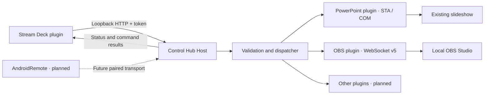

# Project description: Control Hub

[Dansk](project.da.md) · [Home](../README.en.md)

## Purpose and operating context

Control Hub brings presentation control, video production and selected devices together in one local system. An operator should be able to advance slides and switch OBS scenes from the same Stream Deck without moving focus between applications. The system must show whether a command was acknowledged and whether status could be read.

A typical workflow starts with the operator opening the presentation, starting the slideshow, preparing OBS and selecting a Stream Deck profile. A next-slide key calls PowerPoint's slideshow API. An OBS scene key sends a named WebSocket request. A status key shows slide position, recording and streaming. Missing connections produce unknown status or an error; the system must not pretend a device is working.

0.0.001 is the first end-to-end development version. It provides a basis for practical testing and further implementation, not a claim of production readiness.

## Priorities and scope

1. **Stream Deck, PowerPoint and OBS Studio:** establish the complete operating workflow, verify failure paths and test in the active environment.
2. **AndroidRemote:** reuse the command and status contract for mobile control with pairing, secure transport and clear connection state.
3. **Other integrations:** audio, Logitech, Android Live, physical remote and Flux Keyboard once specific devices, protocols and desired functions are established.

AndroidRemote and Android Live are separate integration tracks. Their names do not establish a particular third-party app, product API or hardware model. The same applies to Flux Keyboard, Logitech and the physical remote.

A small Danish/English Windows control window and per-user installer are included: start/stop, connection status, token copying and OBS settings. Settings are encrypted for the Windows user with DPAPI. The host stops when the control window's connection closes. A full visual production dashboard, user profiles, macros, combined scene/slide automation and Windows service installation remain outside the first version. The version number is not a schedule or a percentage-complete metric.

## Architecture

### Contracts

`ControlHub.Contracts` defines commands, results, status, plugin descriptors and `IHubPlugin`. The protocol version is independent of the product version. User-facing messages contain both `da` and `en`; clients select their language. Arguments are JSON objects, and each adapter accepts only its known fields.

### Core

The dispatcher validates the protocol, UUID, plugin and action before an adapter receives a command. Commands are serialized to establish ordering across received actions. The latest 1,024 dispatched command IDs are retained in memory. Reusing the same ID with identical content returns the earlier result; changing the content while reusing an ID is rejected.

This is bounded duplicate protection, not a persistent exactly-once execution guarantee. History disappears on restart and older entries are evicted. Clients must never automatically replay old actions.

### Host

An ASP.NET Core host listens only on `127.0.0.1:5187`. Every API request requires a bearer token of at least 32 characters. Browser requests carrying an Origin header are rejected. Incoming JSON is limited to 16 KiB and 16 levels; at most eight HTTP requests are processed concurrently.

There is no login server, cloud dependency, telemetry service or public listening address. This is a local process API, not an Android LAN server. A future Android transport needs its own concrete security design.

### Plugin system

C# plugins are explicitly registered at startup and advertise their ID, name, maturity and actions. They implement execution, status and asynchronous cleanup. The host does not automatically load unknown DLLs. This is an intentional first-version boundary: plugins are trusted code in the same process, not isolated security units.

All adapter implementations, device-specific documents and Stream Deck assets belong under `Plugins/`. The shared interface lives under `src/`. A new implementation requires a project under `Plugins/`, a host reference, explicit registration, tests and documentation in both languages.

## Integrations

### PowerPoint

The adapter attaches to an already running PowerPoint instance through COM and requires exactly one slideshow window in that instance. Multiple PowerPoint processes and unusual COM registrations need practical verification; selection across processes is not implemented.

COM operations run sequentially on a dedicated STA thread. The adapter uses only slideshow navigation, display state and status reads. It never opens, saves, closes or edits presentation files and does not quit PowerPoint. COM references are released after each call.

Next follows PowerPoint's native Next behaviour, including animation steps and end-of-show behaviour depending on presentation settings. Go-to uses PowerPoint's slide number, while status reports position in the current slideshow; custom shows can therefore have different ordering. This must be documented and tested with the actual show.

### OBS Studio

The adapter uses OBS WebSocket v5 with challenge-response authentication. Actions are explicit: scene selection, start/stop recording, start/stop streaming and setting an input's mute state. There are no focus-based shortcuts or blind recording/streaming toggles.

The first version opens one connection per request. This simplifies recovery after disconnection but adds handshake overhead. Status uses three successive requests and is not an atomic snapshot. Event-driven status and a persistent connection are possible future improvements.

### Stream Deck

The plugin uses Stream Deck's local WebSocket API and Node 24 runtime. It offers 11 command keys and one status key. Settings contain the local token, language and arguments required by the action. Overlapping presses on the same key are suppressed while a request is running; presses after completion are new actions.

The status key normally refreshes every three seconds. A slow request finishes before another refresh begins. Green confirmation requires a valid correlated success response. Errors show an alert and a request to check status. Commands are never automatically retried.

The inspector's **Test connection** reads status without executing production actions. Incorrect tokens, busy hosts, unreachable hosts and missing application connections each have a specific explanation. Late command responses cannot update a key after its settings or profile have changed. Elgato's official validator checks the manifest and assets in CI.

## Failure handling, security and data protection

A timeout may occur after an application receives a command. Therefore `outcome_unknown` does not mean the action never happened. The operator must check status. COM cannot safely be forcibly cancelled; a slow call may finish after the client's timeout.

The local token and OBS password must remain outside GitHub. Stream Deck stores the token in its local settings; do not include it in exported profiles or shared configurations. The host does not explicitly log command bodies or tokens. Plugin failures return controlled bilingual messages rather than raw exceptions.

Loopback and token authentication protect the local API boundary, but trusted plugin code and other programs with access to the user's settings are not isolated. Future remote access must define pairing, TLS, permissions, device revocation and replay rules.

## Quality and development process

Automated tests cover routing, validation, duplicates, timeouts, adapter boundaries, OBS handshakes and Stream Deck behaviour. Host tests cover HTTP access and protocol errors. CI builds and tests on Windows and Linux; Linux coverage applies to the portable core, not PowerPoint COM.

Physical acceptance requires a separate trial using the actual Stream Deck, Office version, OBS configuration and presentation. It covers focus changes, animations, first/last slides, disconnections and presentation file hashes before and after operation. Results must record environment, steps, expected outcome, observed outcome and remaining defects.

All changes go through a PR to `main`. The user-facing version is **0.0.001**; technical package formats normalize it to `0.0.1` and `0.0.1.0`. Every release and tag requires owner approval. Each .100 boundary requires separate approval, and 0.1.000 requires completed, accepted scope and documented testing in the active environment.
